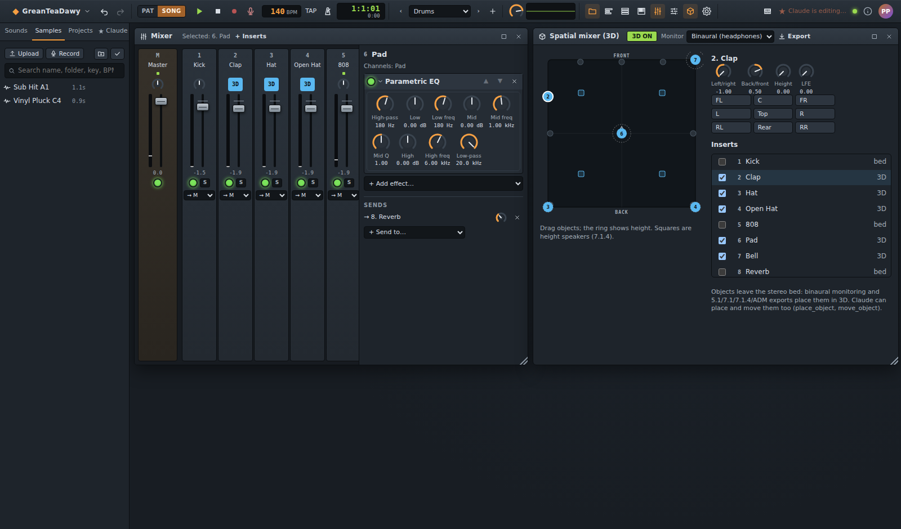
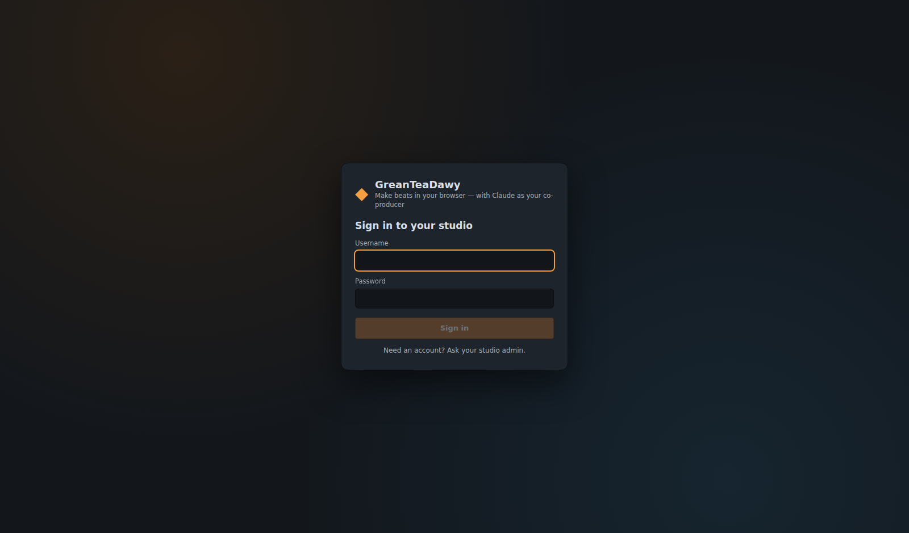
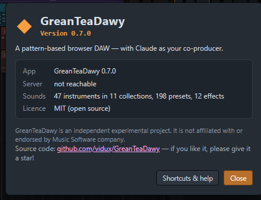

# ◆ Melovra

**Pattern tabanlı, tarayıcıda çalışan bir DAW — yanınızda yardımcı yapımcı olarak Claude.**

Melovra; açık kaynaklı, kendi sunucunuzda barındırdığınız bir beat yapma stüdyosudur: kanal rafı ve step
sequencer, piano roll, playlist, efektli mikser, otomasyon, sampler ve audio klipler — hepsi tarayıcıda çalışır,
arkada Node.js tabanlı bir sunucu durur. Yerleşik [MCP](https://modelcontextprotocol.io) sunucusu Claude'a 78 müzik
üretim aracı verir; böylece *"145 BPM'de karanlık bir trap beat yap ve streaming için miksin"* dersiniz ve her
düzenlemenin stüdyonuzda canlı canlı uygulandığını izlersiniz.

[](LICENSE)


[](docs/screenshots/studio.png)

> Melovra bağımsız bir deneysel projedir. Herhangi bir müzik yazılımı şirketiyle bağlantısı yoktur ve o şirket
> tarafından onaylanmamıştır.

## İçindekiler

- [Özellikler](#özellikler) · [Ekran görüntüleri](#ekran-görüntüleri) · [Hızlı başlangıç](#hızlı-başlangıç) · [Claude ile müzik yapın](#claude-ile-müzik-yapın)
- [Mobil uygulama](#mobil-uygulama) · [Yapılandırma](#yapılandırma) · [Docker](#docker) · [Belgelendirme](#belgelendirme) · [Geliştirme](#geliştirme)
- [Güvenlik](#güvenlik) · [Sorun giderme](#sorun-giderme) · [Katkıda bulunma](#katkıda-bulunma) · [Lisans](#lisans)

## Özellikler

**Stüdyo**

- **Kanal rafı ve step sequencer** — kanal başına volume/pan/mute/solo, swing, pattern uzunluğu, fill'ler, randomize,
  choke grupları, kanal başına groove (ms cinsinden nudge, swing payı), melodik kanallar için mini piano-roll
  önizlemeleri.
- **İfade gücü yüksek velocity** — donanım enstrümanları gibi kare bir eğri; yumuşak notalar daha koyu çalar
  (davullar, filtreler, FM, sampler, piyano/gitar/bas tonu).
- **Enstrümanlar** — sentezlenmiş kick, snare, clap, hi-hat, tom, rim, cowbell, zil, shaker, perc; glide ve distortion
  içeren 808 bas; üç osilatörlü subtractive synth; FM synth; kendi sesleriniz için **sampler**; ve GarageBand tarzı bir
  bant: modellenmiş **grand piano**, **elektrik piyano** (tine/reed), **drawbar org** (percussion, rotary),
  **gitar** (akustik/nylon/elektrik), **bas gitar** (finger/pick/slap/upright) ve **yaylılar** (ensemble veya solo;
  legato, staccato, pizzicato). Dört dünya koleksiyonu: **Flutes** (konser, pan, recorder, tin whistle, ocarina),
  **Beatbox** (ağız kick'i, snare'ler, hat'lar, bas, scratch/click-roll FX), **Indian** (jawari köprülü, sempatik
  telli sitar, tanpura, tabla bol'ları, bansuri, shehnai, santoor, harmonium) ve **East Asian** (koto, guzheng, pipa,
  shamisen, erhu, shakuhachi, dizi, suona, taiko, gong): 47 enstrüman, yaklaşık 200 preset; ayrıca Japon pentatonik ve
  Hindistan thaat dizileri.
- **Piano roll** — çiz/seç/sil araçları, akor damgası, snap, quantize, legato, humanize, dizi vurgulama, ghost
  notalar, velocity şeridi, kopyala/yapıştır/çoğalt, klavyeyle nudge.
- **Playlist** — 200 track'e kadar pattern, audio ve otomasyon klipleri; bölüm marker'ları; audio klip gain, fade'leri
  ve tempoya repitch; loop bölgesi; song/pattern modu.
- **Mikser** — fader'lı, pan'lı, routing ve send'li insert'ler; high/low-pass'lı EQ, filter, compressor (paralel
  mix'li), delay, reverb (room size, frekansa bağlı decay), distortion, chorus, phaser, bitcrusher, mono baslı stereo
  genişlik, **kick ile tetiklenen sidechain** ve varsayılan ceiling'ı −1 dB olan, oversampling'li clip kademesi
  bulunan bir limiter. Otomatikleştirilebilen her parametre için otomasyon.
- **Uzamsal (Dolby Atmos tarzı) miksaj** — insert'leri bir odada 3D nesneler yapın (x/y/yükseklik, LFE send),
  otomasyonla hareket ettirin, kulaklıkla **binaural** dinleyin; binaural, **5.1 / 7.1 / 7.1.4** WAV'lar, konum verili
  object stem'ler ya da deneysel **ADM BWF** olarak dışa aktarın ([docs/spatial.md](docs/spatial.md)).
- **Dışa aktarma biçimleri** — WAV (16/24-bit); sunucuda ffmpeg varsa MP3, AAC, Ogg Vorbis, Opus, FLAC, Apple
  Lossless, AIFF (nelerin mevcut olduğunu Ayarlar → Ses Dışa Aktarma gösterir).
- **Pluginler** — kendi **enstrümanlarınızı** (DSP kodu ya da çok örneklemeli), **efektlerinizi** ve **nota
  üreteçlerinizi** `.zip` paketleri olarak ekleyin. Tarayıcıda sandbox içinde çalışırlar (audio worklet / izole, ağ
  erişimi olmayan bir iframe), açık izin isterler ve yalnızca yazarına güvendiğinizi onayladıktan sonra kurulurlar
  ([docs/plugins.md](docs/plugins.md), örnekler [`plugins/`](plugins) içinde).
- **Kayıt** — bilgisayar klavyesinden ya da MIDI klavyeden notalar (Web MIDI), metronom, tap tempo; ayrıca
  **mikrofondan ses kaydı** — tek başına ya da song/pattern üzerine, count-in, metronom ve latency telafisiyle: her
  take, sample olarak kaydedilir ve playlist'te kaydettiğiniz yere yerleştirilir.
- **Sample kitaplığı** — WAV/MP3/OGG/FLAC/AIFF/M4A/WebM yükleme veya kaydetme; **klasörler** (dosyayı sürükleyip
  yerleştirme, toplu taşıma/silme), ada, klasöre, tona veya tempoya göre **arama**; codec, sample rate, bit derinliği,
  bitrate, kanal sayısı, etiketler ve bir analiz (LUFS, peak, spektrum, tempo, ton, pitch, one-shot mı loop mu).
  Kullanımdaki bir sample'ı silmek, hangi projelerin sessiz kalacağını söyler.
- **Wave editörü** — seçim (zero-crossing'e yaslama), kes/kopyala/yapıştır, trim, fade'ler, gain, normalleştirme,
  ters çevirme, invert, DC temizleme, hız, **time stretch**, **pitch shift**, geri al/yinele; yeni bir sample olarak
  kaydedin ya da orijinali her yerde değiştirin (kullanan her projeyi listeleyen bir uyarıyla).
- **Pitch düzeltme** — bir vokali ya da solo enstrümanı amount, speed ve flatten ayarlarıyla (doğaldan robotiğe)
  projenin tonuna ve dizisine akort edin (auto-tune); söylenen ve düzeltilmiş pitch'i görün; tek tek notaları elle
  yukarı/aşağı sürükleyin.
- **Projeler** — trap, drill ve afrobeats'ten bossa nova, cinematic ve beatbox jam'e (paylaşılan FX bus'ları ve
  sidechain ile) kadar 18 tür şablonu; sürümler (adlandırılmış anlık görüntüler), geri al/yinele; 16-bit (dither'lı)
  veya 24-bit WAV, **stem'ler**, MIDI ve proje dışa aktarma, MIDI içe aktarma.
- **Canlı eşzamanlama** — sekmeler ve cihazlar arasında; mobil uyumlu düzen, klavyeyle erişilebilir kontroller.

**Claude entegrasyonu (MCP)**

- **Streamable HTTP** (`/mcp`) ve **stdio** (Claude Desktop için) taşıma katmanları.
- 78 araç: projeler, sesler, davullar, akorlar (sembol ya da roma rakamı, jazz/neo-soul voicing'leri), bas çizgileri
  (808 slide'lı derece çizgileri), melodiler, roll'lar, dönüşümler, marker'lı arrangement, otomasyon, mikser ve
  efektler, sample'lar, sürümler, geri alma, play/stop, MIDI ve stem dışa aktarma.
- **Prodüksiyon araçları** — `apply_groove` (boom bap, Dilla, lo-fi, trap, drill, house, afrobeats hisleri),
  `add_fill` (snare roll'ları, tom geçişleri, hat roll'ları, drop-out'lar…), `add_transition` (riser'lar, swell'ler,
  snare build'leri, downbeat'e impact'ler).
- **`render_mix`** — Claude miksi tarayıcınızda render eder ve bir mastering mühendisi gibi okur: integrated LUFS,
  loudness aralığı, true peak, limiter gain reduction, spektral denge, low-end notası ve genişliği, bölüm başına
  loudness ve kanal başına stem'ler — bir teslim hedefine (streaming, club, hip-hop, EDM, broadcast…) göre kesin
  düzeltmelerle.
- **`analyze_sound`** — bir kanalın tek notasını ölçer (pitch, low-end notası, envelope); böylece Claude 808'leri ve
  kick'leri akort eder.
- Sample metadata'sı ve analizi sayesinde Claude seslerinizi doğru seçer, akort eder ve tempoya uydurur; bunları
  arar, klasörlere yerleştirir ve **`edit_sample`** ile düzenler (trim, fade, stretch, pitch shift,
  **pitch düzeltme**) — birini değiştirmesini istemediğiniz sürece yeni sample'lar olarak kaydeder.
- Sizin **pluginleriniz**: `list_plugins`, plugin kanalları ve efektleri, `run_generator` (Claude bunları
  kullanabilir, asla kuramaz).
- Prompt'lar: `make_beat`, `mix_review`, `use_my_samples`, `spatial_mix`.
- Claude Desktop / claude.ai / Claude Code için **Skills** ([`skills/`](skills) içinde): beat yapımı, arrangement,
  hedef değerlere göre miksaj, uzamsal miksaj ve plugin yazarlığı (`npm run skills:pack` yüklenebilir zip'ler üretir).

**Hesaplar ve güvenlik**

- Kullanıcı hesapları (ilk açılışta yönetici kurulumu, isteğe bağlı kayıt olma, yönetici kullanıcı yönetimi),
  kullanıcı başına özel projeler.
- MCP için kişisel **API token'ları** — *Ayarlar → API & MCP* içinde oluşturun, yenileyin veya silin. Kendi
  bilgisayarınızda isteğe bağlı, ağ üzerinden zorunlu.
- scrypt parolalar, hash'lenmiş oturum ve token'lar, CSRF/origin ve host kontrolleri, CSP, rate limit'ler, dışarıya
  açık sunucular için kurulum kodu, sandbox'lı pluginler. Bkz. [docs/security.md](docs/security.md).

## Ekran görüntüleri

| | |
|---|---|
| [](docs/screenshots/studio.png) **Stüdyo** — playlist, kanal rafı, piano roll | [](docs/screenshots/mixer.png) **Mikser** — insert'ler, efektler, send'ler |
| [](docs/screenshots/piano-roll.png) **Piano roll** — dizi vurgulama, velocity şeridi | [](docs/screenshots/samples.png) **Sample kitaplığı** — klasörler, arama, metadata ve analiz |
| [](docs/screenshots/claude-activity.png) **Claude** — canlı etkinlik günlüğü | [](docs/screenshots/settings-api.png) **Ayarlar → API & MCP** — token'lar ve kurulum |
| [](docs/screenshots/spatial.png) **Uzamsal (3D)** — dinleyicinin çevresinde ve üstünde nesneler | [](docs/screenshots/settings-plugins.png) **Pluginler** — kurmadan önce inceleme ve güven onayı |
| [](docs/screenshots/settings-export.png) **Ayarlar → Ses Dışa Aktarma** — ffmpeg ve biçimler | [](docs/screenshots/mobile.png) **Telefon düzeni** |
| [](docs/screenshots/world.png) **Dünya koleksiyonları** — Indian Fusion şablonu, sitar ayarları | [](docs/screenshots/login.png) **Oturum açma** |
| [](docs/screenshots/wave-editor.png) **Wave editörü** — seçim, kesme, fade, stretch, pitch shift | [](docs/screenshots/pitch-correction.png) **Pitch düzeltme** — auto-tune ve elle taşınan notalar |
| [](docs/screenshots/recorder.png) **Kaydedici** — song üzerine take'ler, playlist'e yerleştirme | [](docs/screenshots/about.png) **Hakkında** — uygulama adı ve sürümü (ⓘ, sağ üst) |

## Hızlı başlangıç

Gereksinimler: **Node.js 20.19+** (22 LTS önerilir) ve modern bir tarayıcı.

```bash
git clone <repo-url> melovra && cd melovra
npm install
npm run build
npm start                 # → http://127.0.0.1:3001
```

1. http://127.0.0.1:3001 adresini açın ve **yönetici hesabını oluşturun** (ilk çalıştırma).
2. Hazır bir **Welcome Trap Beat** projesi sizi bekler — sesi etkinleştirmek için bir kez tıklayın ve **Space**
   tuşuna basın.
3. [Kullanıcı rehberini](docs/user-guide.md) okuyun ya da doğrudan aşağıdaki Claude bölümüne atlayın.

Hot reload'lu geliştirme modu: `npm run dev` → http://localhost:5173.

## Claude ile müzik yapın

Stüdyoyu tarayıcınızda açık tutun, ardından bir istemci bağlayın. *Ayarlar → API & MCP* bu komutları URL'niz ve
token'ınız doldurulmuş hâlde gösterir.

**Claude Code**

```bash
claude mcp add --transport http melovra http://localhost:3001/mcp \
  --header "Authorization: Bearer <your gtd_ token>"
```

**Claude Desktop** — `claude_desktop_config.json`:

```json
{
  "mcpServers": {
    "melovra": {
      "command": "node",
      "args": ["/absolute/path/to/melovra/server/src/mcp/stdio.js"],
      "env": { "MELOVRA_URL": "http://127.0.0.1:3001", "MELOVRA_TOKEN": "<your gtd_ token>" }
    }
  }
}
```

Token, kendi bilgisayarınızda isteğe bağlıdır (bir yönetici ayarı token'sız yerel erişime izin verir) ve ağ üzerinden
sunucuya ulaşan her şey için zorunludur. Sonra şunu deneyin:

> *F majörde, jazzy 7th akorlarıyla, swing'li tozlu davullar ve sıcak bir basla 80 BPM'de lo-fi bir beat yap.
> Intro/verse/hook/outro olarak düzenle, yaklaşık −14 LUFS'a miksin, bir sürüm kaydet ve çal.*

Dahası: [Claude ile müzik yapmak](docs/claude-mcp.md) · [MCP araç referansı](docs/MCP.md).

## Yapılandırma

Ortam değişkenleri (veya bir `.env` dosyası — bkz. [`.env.example`](.env.example)):

| Değişken | Varsayılan | |
|----------|---------|---|
| `PORT` / `HOST` | `3001` / `127.0.0.1` | dinlenecek adres (`0.0.0.0` Docker/LAN için) |
| `DATA_DIR` | `./data` | projeler, sample'lar, dışa aktarmalar, hesaplar |
| `PUBLIC_URL` | — | harici URL (Claude için bağlantılar, izin verilen origin) |
| `ALLOWED_HOSTS` | loopback'te localhost | Host header izin listesi |
| `TRUST_PROXY` | off | ters proxy arkasında ayarlayın (hop sayısı) |
| `SESSION_TTL_DAYS` | `30` | oturum açma ömrü |
| `SETUP_CODE` | rastgele, log'da | ilk açılış yönetici kurulum kodu (uzak veya proxied kurulum) |
| `MCP_TOKEN` | — | eski paylaşılan MCP token'ı (token'sız MCP'yi kapatır) |
| `MAX_UPLOAD_MB` | `50` | sample yükleme sınırı |
| `FFMPEG_PATH` | PATH'te `ffmpeg` | MP3/AAC/Ogg/Opus/FLAC/ALAC/AIFF dışa aktarma (`off` kapatır) |
| `PLUGINS_ENABLED` | `true` | kullanıcıların kendi pluginlerini kurmasına izin ver (ayrı bir yönetici ayarı da var) |
| `MELOVRA_URL` / `MELOVRA_TOKEN` | — | stdio köprüsü için |

Tüm ayrıntılar: [docs/deployment.md](docs/deployment.md).

## Mobil uygulama

Melovra'nın **React Native (Expo) mobil uygulaması** `mobile/` klasöründedir: kanal rafı, step sequencer,
pattern'lar, playlist, mikser ve sunucu bağlantısı — telefonunuzda. Detaylar: [mobile/README.md](mobile/README.md).

```bash
cd mobile
npm install
npx expo start        # QR kod ile Expo Go'da açın
```

## Docker

```bash
cp .env.example .env               # isteğe bağlı ayarlar
docker compose up -d --build       # stüdyo http://localhost:3001 adresinde (ffmpeg dahil)
docker compose logs melovra        # ilk çalıştırma: yönetici hesabı kurulum kodu
```

Diğer bilgisayarlar için pakette gelen Caddy profiliyle HTTPS ekleyin (`DOMAIN`, `PUBLIC_URL`, `ALLOWED_HOSTS`,
`TRUST_PROXY=1` değerlerini ayarladıktan sonra `docker compose --profile proxy up -d`). Yapılandırma, yedekler,
yükseltmeler ve sertleştirme: [docs/docker.md](docs/docker.md); diğer ters proxy'ler ve systemd:
[docs/deployment.md](docs/deployment.md).

## Belgelendirme

| | |
|---|---|
| [Başlangıç](docs/getting-started.md) | kurulum, ilk çalıştırma, ilk beat |
| [Mobil uygulama](mobile/README.md) | React Native uyarlaması: kurulum, özellikler, sınırlar |
| [Kullanıcı rehberi](docs/user-guide.md) | her pencere, araç ve kısayol |
| [Claude ile müzik yapmak](docs/claude-mcp.md) | bağlantı, token'lar, `render_mix`, ipuçları |
| [MCP referansı](docs/MCP.md) | tüm araçlar ve parametreler (üretilmiş) |
| [Uzamsal miksaj](docs/spatial.md) | 3D nesneler, binaural, 5.1 / 7.1.4, ADM |
| [Pluginler](docs/plugins.md) | enstrüman, efekt ve üreteci yazma, paketleme ve kurma |
| [Docker](docs/docker.md) | image, compose, HTTPS, yedekler |
| [Dağıtım](docs/deployment.md) | Docker, proxy'ler, ortam değişkenleri, yedekler |
| [Güvenlik](docs/security.md) | kimlik doğrulama modeli ve sertleştirme kontrol listesi |
| [Mimari](docs/architecture.md) | operasyonlar, canlı eşzamanlama, tarayıcı işleri, audio engine |
| [REST & WebSocket API](docs/api.md) | betikler ve entegrasyonlar için |
| [Geliştirme](docs/development.md) | dizin düzeni, betikler, testler, kurallar |
| [Yol haritası ve ürün incelemesi](docs/roadmap.md) | müzik endüstrisi incelemesi, yapılanlar ve sıradakiler |

## Geliştirme

```bash
npm run dev          # server + client with hot reload
npm run lint         # ESLint
npm test             # unit & integration tests
npm run test:e2e     # Playwright end-to-end (npx playwright install chromium once)
npm run docs:mcp     # regenerate docs/MCP.md
npm run screenshots  # regenerate README screenshots
npm run plugin:pack -- <folder> | --examples   # validate + zip a plugin
```

```
packages/core   shared model, ops, music theory, MIDI, audio analysis
server          Express + WebSocket hub + MCP server + accounts
client          React UI + Web Audio engine
mobile          React Native (Expo) mobil uygulaması
e2e             Playwright tests (a real browser plus an MCP client playing "Claude")
plugins         example plugins (npm run plugin:pack -- --examples → plugins/dist/*.zip)
skills          music-production skills for Claude users (npm run skills:pack → skills/dist/*.zip)
docs            documentation
.claude         skills & agents for developing Melovra with Claude Code (see CLAUDE.md)
```

Claude Code ile kod üzerinde mi çalışıyorsunuz? [CLAUDE.md](CLAUDE.md) ile başlayın; sık yapılan değişikliklerin
tarifleri `.claude/skills/` içindedir, `.claude/agents/` içinde ise bir QA inceleyicisi ve bir müzik endüstrisi
danışmanı vardır.

## Güvenlik

Varsayılan olarak özel: `127.0.0.1` adresini dinler, her hesabın verisi özeldir, token'lar ve oturumlar hash'lenmiş
olarak saklanır. Ağa açmadan önce [docs/security.md](docs/security.md) dosyasını okuyun (HTTPS, `PUBLIC_URL`,
`ALLOWED_HOSTS`, `TRUST_PROXY`, her MCP istemcisi için token) — ters proxy arkasında her zaman `PUBLIC_URL`
ayarlayın. Güvenlik açıklarını lütfen özel olarak (gizlice) bildirin.

## Sorun giderme

| Sorun | Çözüm |
|---------|-----|
| Ses yok | Bir kez herhangi bir yere tıklayın (tarayıcılar bir etkileşim ister), master ses düzeyini ve mute'ları kontrol edin. |
| Claude: "No studio is open in a browser" | Stüdyoyu açık tutun ve token'ın hesabıyla oturum açmış olun. |
| Claude: `/mcp` üzerinde 401 | Ayarlar → API & MCP içinde bir token oluşturun; token'sız erişim yalnızca yereldir ve kapatılabilir. |
| Yönetici parolasını unuttunuz | Sunucuyu durdurun ve `npm run reset-password -- <username>` komutunu çalıştırın. |
| Port kullanımda | `PORT=3002 npm start` |

## Katkıda bulunma

Issue'lar ve pull request'ler memnuniyetle karşılanır — önce [CONTRIBUTING.md](CONTRIBUTING.md) dosyasını okuyun.
Lütfen `npm run lint && npm test && npm run test:e2e` komutlarını çalıştırın ve değişikliğinizle birlikte belgeleri
güncelleyin; repo düzeni ve kurallar [docs/development.md](docs/development.md) içindedir.

## Lisans

[MIT](LICENSE) © Melovra katkıcıları.
