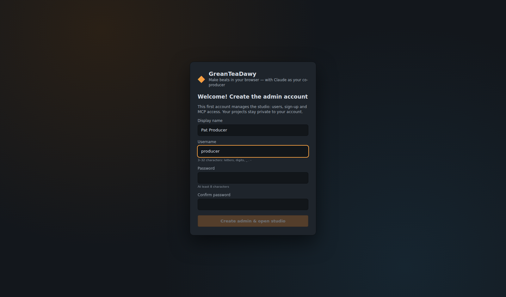

# Başlangıç

## Gereksinimler

- **Node.js 20.19+** (22 LTS önerilir) ve npm
- Modern bir masaüstü tarayıcı (Chrome, Edge, Firefox veya Safari). Telefonlar da çalışır; sadeleştirilmiş bir sekme
  düzeniyle.
- İsteğe bağlı: Claude ile müzik yapmak için [Claude Code](https://docs.claude.com/en/docs/claude-code/overview) veya
  Claude Desktop.
- İsteğe bağlı: MP3/AAC/Ogg/Opus/FLAC/ALAC/AIFF dışa aktarmaları için sunucuda **ffmpeg** (`apt install ffmpeg`,
  `brew install ffmpeg`, `winget install ffmpeg`). WAV dışa aktarma bunu hiçbir zaman gerektirmez.

Konteynerleri mi tercih ediyorsunuz? `docker compose up -d --build` her şeyi çalıştırır (ffmpeg dahil) — bkz.
[Docker](docker.md).

## Kurulum ve çalıştırma

```bash
git clone <your fork or the release zip> melovra
cd melovra
npm install
npm run build      # builds the web UI into client/dist
npm start          # http://127.0.0.1:3001
```

Hot reload'lu geliştirme için `npm run dev` kullanın ve **http://localhost:5173** adresini açın (Vite, `/api`, `/mcp`
ve `/ws` isteklerini 3001 portundaki sunucuya yönlendirir).

Veriler (projeler, sürümler, sample'lar, dışa aktarmalar, hesaplar) `./data` içinde saklanır — `DATA_DIR` ile
değiştirin. Tüm ayarlar için bkz. [dağıtım](deployment.md).

## İlk çalıştırma: yönetici hesabını oluşturma



İlk ziyarette **yönetici hesabı oluşturma** ekranı görünür. Yönetici; kullanıcıları, kayıt olmayı ve MCP erişimini
yönetir; her hesabın projeleri ve sample'ları yalnızca o hesaba özeldir.

- Sunucuyla aynı bilgisayardaki bir tarayıcıdan kod gerekmez.
- Başka bir bilgisayardan — ya da bir ters proxy / tünel üzerinden, ya da `TRUST_PROXY` / herkese açık bir
  `PUBLIC_URL` ayarlandığında — form ayrıca bir **kurulum kodu** ister. Kod, sunucu başlarken sunucu log'una yazılır
  (veya `SETUP_CODE` ile kendinizinkini ayarlayın); böylece yeni kurulmuş bir sunucunun yönetici hesabını başkası
  ele geçiremez.

Her yeni hesap, çalınmaya hazır bir **Welcome Trap Beat** projesiyle başlar. Sesi etkinleştirmek için bir kez
herhangi bir yere tıklayın (tarayıcılar bir etkileşim ister), sonra **Space** tuşuna basın.

## Beat'i elle yapın (2 dakika)

1. **Kanal Rafı** (F6): kick, clap ve hat'ları programlamak için step'lere tıklayın. Sağ tık siler.
2. **Piano roll** (F7): melodik bir kanal seçin, nota çizin; taşımak için sürükleyin, boyutlandırmak için sağ
   kenardan sürükleyin.
3. **Playlist** (F5): araç çubuğundan bir pattern seçin ve düzenlemeye boyayın; **SONG** moduna geçin.
4. **Mikser** (F9): insert'leri dengeleyin, efekt ekleyin (EQ, compressor, reverb, delay, pump, limiter…).
5. **Dosya menüsü → Dışa Aktar** ile WAV veya MIDI olarak kaydedin ya da büyük değişikliklerden önce bir **sürüm**
   kaydedin.

[Kullanıcı rehberi](user-guide.md) her şeyi ayrıntılı olarak anlatır.

## Claude ile beat yapın

1. **Ayarlar → API & MCP** ekranını açın (dişli simgesi ya da avatar menüsü).
2. İsterseniz kişisel bir **API token'ı** oluşturun (önerilir; MCP ağ üzerinden kullanılacaksa zorunludur).
3. Claude Code için komutu kopyalayın, örneğin:

   ```bash
   claude mcp add --transport http melovra http://localhost:3001/mcp \
     --header "Authorization: Bearer gtd_…"
   ```

4. Stüdyoyu tarayıcıda açık tutun ve sorun: *"Kayan (slide) bir 808 ile 145 BPM'de karanlık bir trap beat yap;
   intro/hook/verse olarak düzenle, yaklaşık −14 LUFS'a miksin ve çal."* Claude'un düzenlemelerinin canlı canlı
   uygulandığını izleyeceksiniz.

Ayrıntılar, Claude Desktop kurulumu ve ipuçları: [Claude ile müzik yapmak](claude-mcp.md).

## Sorun giderme

| Belirti | Çözüm |
|---------|-----|
| Ses yok | Sayfada bir kez tıklayın (ses açma banner'ı). Master fader'ı ve kanal/insert'in mute olmadığını kontrol edin. |
| "Sunucuya ulaşılamıyor" | `npm start` / `npm run dev` çalışıyor mu? Port boş mu? |
| Claude "No studio is open in a browser" diyor | `render_mix`, `play` ve MP3 analizi, stüdyonun açık olmasını (ve aynı hesapla oturum açılmış olmasını) gerektirir. |
| Claude `/mcp` üzerinden 401 alıyor | Ayarlar → API & MCP içinde bir token oluşturun ve Bearer header (ya da `?token=`) ile iletin. Token'sız MCP, yalnızca yönetici izin verirse ve yalnızca aynı bilgisayardan çalışır. |
| Parolayı unuttunuz | Yöneticiler **Ayarlar → Kullanıcılar** ekranından herhangi bir kullanıcıya yeni parola belirleyebilir. Yöneticinin kendisi için: sunucuyu durdurun ve `npm run reset-password -- <username>` komutunu çalıştırın. |
