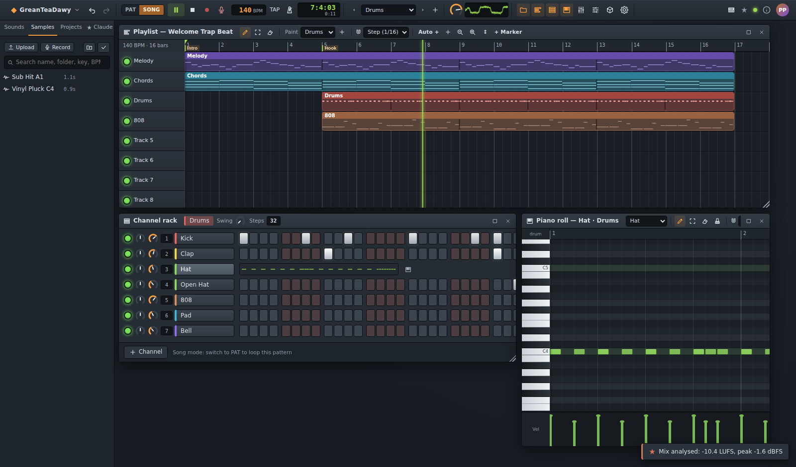
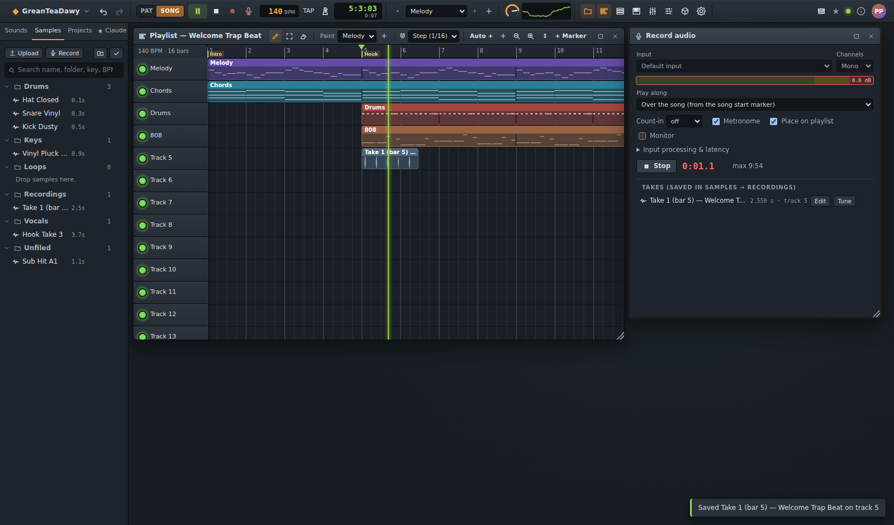
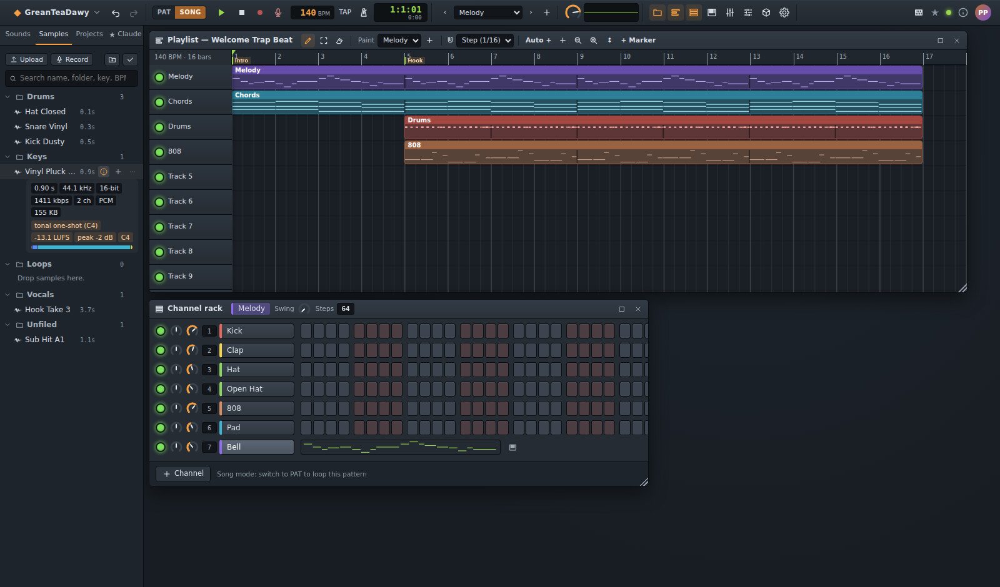
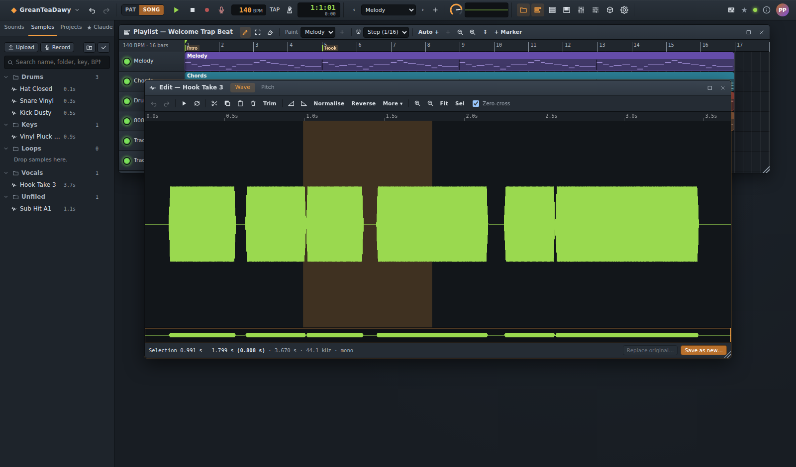
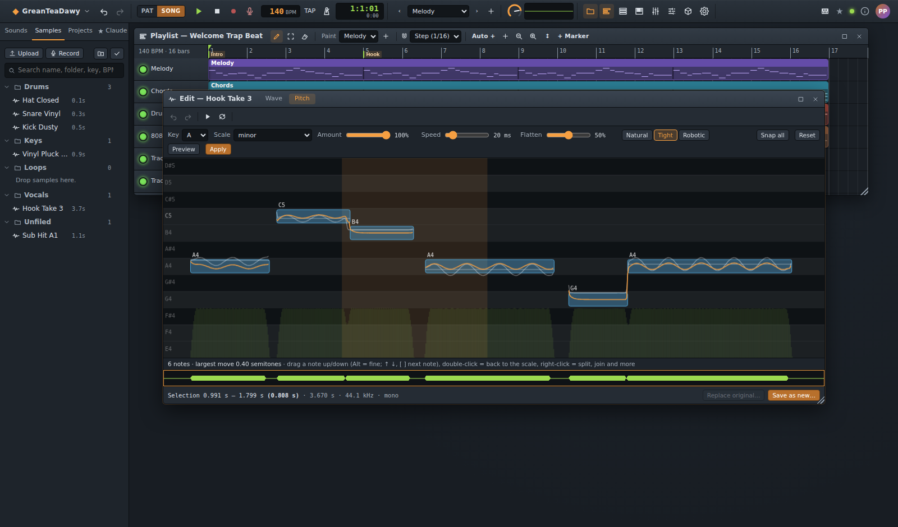

# Kullanıcı rehberi

Melovra bir pattern-playlist iş akışı kullanır: **pattern'leri** (davul groove'ları, akor bölümleri,
melodiler) **kanal rafında** ve **piano roll'de** kurarsınız, **playlist'te** düzenlersiniz ve her şeyi
**mikserde** dengelersiniz. Her şey otomatik kaydedilir ve tarayıcı sekmelerinizle Claude arasında canlı canlı
eşzamanlanır.

## Düzen

- **Araç çubuğu** — menü (◆), geri al/yinele, PAT/SONG modu, play/stop/record, 🎙 (ses Kaydedici), tempo (sürükleyin
  veya çift tıklayın; tap tempo için TAP), metronom, song konumu, geçerli pattern (‹ › ve pattern seçenekleri için
  +), master ses düzeyi ve çıkış ölçeri (scope/spektrum için tıklayın), pencere düğmeleri, Ayarlar, MIDI, Claude
  etkinlik ışığı, bağlantı ışığı, **Hakkında** (ⓘ, sağ üst: uygulamanın adını ve sürümünü, sunucu sürümünü ve
  derlemeye neyin dahil olduğunu gösteren bir pencere; ayrıca ◆ → Hakkında) ve hesap menünüz. Hakkında penceresi
  sunucunun başka bir sürümü çalıştırdığını söylüyorsa sayfayı yeniden yükleyin.
- **Tarayıcı** (sol tarafta, Alt+F8) — *Sesler* (tüm enstrümanlar ve preset'ler: eklemek için tıklayın, rafa
  sürükleyin), *Sample'lar* (klasörlerde sample kitaplığınız: yükleme, kaydetme, arama, düzenleme), *Projeler*
  (şablonlar, açma/çoğaltma/silme, dışa aktarmalar),
  *Claude* (MCP kurulumu ve Claude'un yaptıklarının canlı etkinlik günlüğü).
- **Pencereler** — Playlist (F5), Kanal Rafı (F6), Piano roll (F7), Kanal Ayarları (F8), Mikser (F9); ayrıca
  Otomasyon, Sürümler, Ayarlar, Yardım, **wave editörü** ve **Kaydedici**. Pencereyi taşımak için başlık çubuğunu
  düğmelerinin ve alanlarının dışında herhangi bir yerden sürükleyin, boyutlandırmak için köşesinden sürükleyin,
  ekranı kaplaması için çubuğa çift tıklayın. Düzen tarayıcıya göre hatırlanır.
- Dar ekranlarda pencereler tam ekran sekmelere dönüşür (alt çubuk). Tek parmak piano roll'ü ve playlist'i
  sürükleme/kaydırma yapar, tek dokunuş çizer.

## Kanal rafı ve step sequencer

- Her satır, mute/solo LED'i, volume ve pan düğmeleri, mikser insert numarası, adı ve 16+ step'i olan bir
  **kanaldır** (bir enstrüman). Step'leri açıp kapatmak için tıklayın, boyamak için sürükleyin, silmek için sağ
  tıklayın; velocity için bir step'in üzerinde fare tekerleğini kullanın.
- **Swing** ve **Steps** (pattern uzunluğu) raf başlığındadır.
- Kanal adına sağ tıklayın: piano roll, ayarlar, yeniden adlandırma, renk, klonlama, her 2/4/8 step'te bir doldurma,
  kaydırma, randomize, temizleme, taşıma, silme.
- Notaları step ızgarasına sığmayan kanallar (melodiler, akorlar, ızgara dışı zamanlamalar) step'ler yerine bir mini
  piano roll gösterir — piano roll'ü açmak için tıklayın.
- **+ Kanal** enstrüman ekler: sentezlenmiş davullar (kick, snare, clap, hat, tom, rim, cowbell, zil, shaker, perc),
  808 bas, üç osilatörlü subtractive synth, FM synth, **sampler** (yüklediğiniz sesler) ve bant enstrümanları
  (Tarayıcı kategorileri *Keys*, *Guitar*, *Bass*, *Strings*):
  - **Grand Piano** — modellenmiş bir piyano (inharmoik teller, çekicin sertliği velocity'yi izler, çakışan
    unison'lar). Bir nota bitene kadar çalar; uzun notalar sustain pedalı gibi çalışır. *Damper*, bırakılan notanın
    ne kadar hızlı duracağını ayarlar.
  - **Elektrik Piyano** — tine (Rhodes tarzı) veya reed (Wurlitzer tarzı); *Bark* sert notaların hırıltısı için,
    *Bell* atak tınlaması içindir; stereo veya genlik tremolo.
  - **Drawbar Org** — dokuz drawbar (16′ … 1′), percussion (2./3. harmonik), tuş tıkırtısı, drive ve yavaş/hızlı bir
    rotary hoparlör. Gerçeği gibi velocity'ye neredeyse hiç duyarlı değildir.
  - **Gitar** — akustik, nylon veya elektrik gövdeli, tıngırdatma noktası (pluck point), palm mute ve drive içeren
    çekilmiş-tel modeli.
  - **Bas Gitar** — finger, pick, slap veya upright; varsayılan olarak glide'lı mono (üst üste binen notalar kayar).
  - **Yaylı Topluluk** — nota başına 1–8 çalgıcı (1 = solo çello/keman), gecikmeli vibrato; legato, staccato veya
    pizzicato artikülasyonları.

  Piyano, gitar, bas ve pizzicato notaları arka planda her pitch ve velocity katmanı için bir kez render edilir
  (ekledikten birkaç yüz milisaniye sonra); sonrasında çalmaları neredeyse hiç maliyet gerektirmez.
- **Dünya koleksiyonları** (Tarayıcı bölümleri *Flutes*, *Beatbox*, *Indian*, *East Asian*; **+ Kanal** içinde her
  bölüm bir alt menüdür → enstrüman → preset):
  - **Flutes** — Flüt (Concert, Breathy, Lo-fi, Trap, Alto, Piccolo), Pan Flüt, Recorder, Tin Whistle ve Ocarina tek
    bir nefes motoru paylaşır: *Tone* (daha güçlü üflemek daha parlak bir overblow yapar; velocity de aynısını
    yapar), *Breath* (hava gürültüsü), *Chiff* (dilli atak), gecikmeli *Vibrato*. Üst üste binen notaların
    birbirine bağlanması (slur) için *Mono*'yu açın.
  - **Beatbox** — ağız sesleri: *Kick* ("B" dudak patlaması), *Snare* (Pf, Psh tükürme, içe K, Kch), *Hat* (t, ts,
    içe, tch), *Bas* ("oo/oh/ah/mm" ünlüsünden geçen dudak/boğaz vınlaması, growl ve "wub" wobble) ve *FX* (click
    roll, vokal scratch, laser zap, siren). Kapalı ve açık hat'ları tek bir choke grubuna koyun.
  - **Indian** — **Sitar** (vınlı bir *jawari* köprüsü üzerinde modellenmiş tel, *Sa*'nın majör dizisine akortlu
    sempatik teller; üst üste binen notaların kayması için varsayılan olarak mono — *meend*), **Tanpura** (vınlı
    drone: Sa ve Pa'yı uzun, tekrarlı notalar olarak çalın), **Tabla** (her bol için bir kanal: na, tin, tun, te,
    ge, ke, dha, dhin; *Bend*, ge'deki avuç kaydırmasıdır; tiz davul C4'te C üzerine oturur — akort etmek için
    Sa'nızın notasını çalın), **Bansuri** (meend'li, nefesli bambu flüt), **Shehnai** (burunlu çift kamış),
    **Santoor** (çekiçli, çınlayarak süren teller) ve **Harmonium** (bas/erkek/kadın kamış bankaları ve tüm
    notaların paylaştığı körük atışı).
  - **East Asian** — **Koto** ve **Guzheng** (çekilli zither'lar; basılı tel bend'leri için *Mono*), **Pipa**
    (parlak, tırnakla çekilen lute; hızlı tekrarlı notalar onun tremolosunu verir), **Shamisen** (bachi "thwack"
    sesi ve vınlı sawari; Tsugaru preset'i), **Erhu** (derin vibrato ve kaydırmalarıyla şarkı söyleyen iki telli
    keman), **Shakuhachi** (nefesli, kabaran ataklar), **Dizi** (vınlı membranlı parlak flüt), **Suona** (gürültülü,
    şenlikli çift kamış), **Taiko** (odaiko, chudaiko, shime, kara rim) ve **Gong** (tam-tam bloom, aşağı ya da
    yukarı bükülen opera gong'ları, tapınak çanı).
  - Sitar, tanpura, santoor, koto, guzheng, pipa ve shamisen, gitar gibi arka planda render edilen fiziksel
    modellerdir. Dizileri piano roll'ün dizi listesinde bulunur: *hirajoshi*, *inSen*, *iwato*, *yo* (Japon) ve
    *bhairav*, *todi*, *purvi*, *marwa* thaats'leri (Bilawal, Kalyan, Khamaj, Kafi, Asavari ve Bhairavi sırasıyla
    majör, lydian, mixolydian, dorian, minör ve phrygian'dır).
- **Velocity**, donanım enstrümanları gibi kare bir eğriyi izler (1.0 = 0 dB, 0.8 = −4 dB, 0.45'teki bir ghost nota
  = −14 dB) ve yumuşak notalar daha koyu çalar: snare'ler, hat'lar, clap'lar, synth filtreleri, FM parlaklığı,
  sampler cutoff'u ve piyano/e-piyano/gitar/bas tonu hep tepki verir. Aksanları ve sessiz off-beat'leri programlamak
  groove'a nefes aldıran şeydir.

## Kanal Ayarları (F8)

Enstrüman türü ve preset'i, enstrümanın her parametresi (osilatörler, envelope'lar, filtre, glide/mono, FM oranları,
808 distortion'ı…), kanal volume/pan/pitch'i, kanal filtresi (cutoff/rezonans), **choke grubu** (örn. açık/kapalı
hat'lar birbirini keser), step notası (root ton) ve mikser routing'i. Sampler kanalı oluşturmak için bir sample'ı
rafa bırakın.

- **Groove**: *Nudge*, kanalı 50 ms'ye kadar erken (−) veya geç (+) çalar — +10…+20 ms'de gevşek bir snare, −3 ms'de
  öne itilmiş hat'lar gibi; *Swing* ise projenin swing'inin ne kadarını bu kanalın alacağını ayarlar (düz bir kick
  üzerinde swing'li hat'lar). Swing, ızgaranın hafif dışında duran notalara da uygulanır; böylece humanize edilmiş
  bölümler hissini korur.
- **Sampler**: başlangıç/bitiş trim'i, sustain bir **loop** (loop başlangıcı/bitişi; *One shot* kapalıyken nota
  basılı tutulduğu sürece çalar), reverse, velocity'ye duyarlı low-pass bir **cutoff**, gain ve bir amp envelope'u.
- Bilinmeye değer preset'ler: *Lo-fi Keys*, *Strings*, *Riser Noise*, *Reverse Swell* (subtractive synth),
  *Felt Piano* (FM), *Sub Drop* (808).

## Piano roll (F7)

- Araçlar: **Çiz** (eklemek için tıklayın, taşımak için sürükleyin, boyutlandırmak için sağ kenarı sürükleyin),
  **Seç** (kutu; Ctrl+sürükle de seçer), **Sil** (veya sağ tık), **Akor damgası** (majör, minör, 7'li, 9'lu… seçin
  ve akor yerleştirmek için tıklayın).
- Snap ızgarası, quantize (Ctrl+Q), legato, humanize, oktav yukarı/aşağı, dizi vurgulama (ton + dizi), diğer
  kanalların ghost notaları, zoom ve tuş yüksekliği.
- Tuşlar: Ctrl+A/C/V/D, Delete, ↑/↓ transpoze (Shift = oktav), ←/→ nudge. Altta velocity şeridi.
- Notaları dinlemek için soldaki klavyeye tıklayın.

## Playlist (F5) ve song modu

- Bir pattern seçin (araç çubuğu ya da playlist araç çubuğu) ve boyamak için tıklayın; klip'ler, kendileri daha
  uzun olduğunda pattern'lerini loop'lar. Taşımak için sürükleyin, boyutlandırmak için sağ kenar, kırpmak için sol
  kenar (klip, pattern'inde/sesinde daha geç başlar). Shift+sürükle çoğaltır; mute/çoğaltma/silme için sağ tık.
- **Audio klip** oluşturmak için tarayıcıdan bir sample'ı bir track üzerine sürükleyin. **Klip gain**, **fade'ler**
  (klip üzerine çizilir) ve **proje temposuna uydur** için sağ tıklayın — bu, çalma hızını (ve pikap gibi pitch'i)
  değiştirir; böylece başka bir tempodaki loop ızgaraya kilitlenir; *Orijinal hız* bunu geri alır.
- **Marker'lar**, cetvelin üzerinde song bölümlerini adlandırır: cetvele sağ tıklayın → *Marker ekle* (veya
  playlist araç çubuğunda **+ Marker**, song başlangıç konumunda); song başlangıcını oraya taşımak için bir
  marker'a tıklayın, yeniden adlandırmak veya silmek için sağ tıklayın. Claude'un `arrange_song` aracı, adlandırılmış
  her bölüm için bunları oluşturur.
- **Auto +**, bir kanal, mikser, efekt veya master parametresi için otomasyon klibi oluşturur; eğrisini Otomasyon
  penceresinde düzenleyin.
- Song başlangıcını ayarlamak için cetvele tıklayın, loop bölgesi belirlemek için üzerinde sürükleyin (sağ tık →
  loop'u temizle). Düzenlemeyi çalmak için **SONG** moduna geçin (Shift+L, PAT/SONG arasında geçiş yapar).

## Mikser (F9)

- Insert 0 **Master**'dır (varsayılan olarak bir limiter'la); her kanal bir insert'e yönlendirilir (raf satırındaki
  numara).
- Fader'lar (çift tık sıfırlar), pan, mute/solo, başka bir insert'e routing (→) ve **send'ler** (örn. birkaç
  insert'ten paylaşılan bir reverb bus'ına). Routing döngüleri otomatik olarak engellenir.
- Seçili insert, kendi efekt zincirini gösterir. Ekleyin, bypass yapın, sıralayın, kaldırın. Çoğu sürekli parametre
  otomatikleştirilebilir: playlist'te **Auto +** ile bir otomasyon klibi oluşturun.

| Efekt | Öne çıkanlar |
|--------|-----------|
| EQ | low shelf, mid peak, high shelf; ayrıca **high-pass** ve **low-pass** (12 dB/oktav; 20 Hz / 20 kHz = kapalı) |
| Filter | rezonans ve mix'li low/high/band-pass ve notch — sweep'ler için cutoff'u otomatikleştirin |
| Compressor | threshold, ratio, attack, release, knee, makeup ve **mix** (1'in altı = paralel compression; kuru yol delay'e hizalıdır). Tarayıcının otomatik makeup'u kaldırılmıştır; *Makeup* eklediğiniz tek gain'dir |
| Delay | tempo-sync'li, ping-pong, tone; tekrarlar high-pass'lidir, yankılar low end'de kalmaz |
| Reverb | decay, **size** (erken yansımalar), pre-delay, damping; tizleri pesinden daha hızlı sönen, üretilmiş bir oda |
| Distortion, Chorus, Phaser, Lo-fi Crusher | saturation (4× oversampled), modülasyon, bit azaltma |
| Stereo Shaper | genişlik artı **mono below** (low end'i mono tutar, örn. bas ve pad'lerde 120 Hz) |
| Sidechain Pump | **trigger kanalı**: o kanalın her notasında duck yapar (genelde kick — mute'lu bir "ghost" kick bile); trigger yoksa tempo ızgarasına göre pompalar |
| Limiter | input gain, ceiling (varsayılan −1 dB) ve release; sert sürüldüğünde peak'ler tavanın hemen altına konar (oversampling'li bir soft clip son kısmı yuvarlar — true peak'i `render_mix` ile kontrol edin). Master fader ondan sonra gelir — 0 dB'de tutun |

- Şablonların izlediği iyi alışkanlıklar: her kanala ayrı reverb yerine send'lerle beslenen tek bir **paylaşılan
  reverb/delay** insert'i, kick ve bas dışındaki her şeyde high-pass ve kick'in altında duck yapan bas.
- Düğmeler ve fader'lar klavyeyle de çalışır: Tab ile odaklayın, sonra ok tuşları (Shift = ince ayar), Page
  Up/Down, Home/End, sıfırlamak için Delete.

## Uzamsal mikser (3D)

Insert'leri dinleyicinin çevresine ve üstüne **3D nesneler** olarak yerleştirin, kulaklıkla binaural dinleyin ve
binaural, 5.1, 7.1, 7.1.4, konumlu object stem'ler veya (deneysel) ADM BWF olarak dışa aktarın. Her şeyi şurada:
[Uzamsal miksaj](spatial.md).

## Pluginler

Kendi enstrümanlarınızı, efektlerinizi ve nota üreteçlerinizi (ya da güvendiğiniz birinin yaptıklarını) `.zip`
paketleri olarak ekleyin: **Ayarlar → Pluginler → Plugin kur…**. Hiçbir şey kurulmadan önce stüdyo kimin yaptığını,
neyi istediğini (izinler), dosyalarını ve parmak izini gösterir ve yalnızca güvendiğiniz kişilerin pluginlerini
kurmanızı önerir — *…'a güveniyorum* kutusunu işaretleyin ve **Plugin kur** deyin. Pluginler yalnızca sizindir;
onları buradan kapatıp kaldırabilirsiniz.

- **Enstrüman pluginleri**, Tarayıcı'nın Sesler sekmesinin en üstündeki *Pluginler* bölümünde görünür; düğmeleri ve
  preset'leri her enstrüman gibi Kanal Ayarları'ndadır.
- **Efekt pluginleri**, her insert'in *+ Efekt ekle…* listesindedir (*Plugin: …*); yuvasında bir preset seçici
  vardır; otomatikleştirilebilen düğmeler otomatikleştirilebilir.
- **Üreteçler**, açık pattern/kanalı notalarla doldurur: piano roll → **Gen** → bir üreteç, preset ve uzunluk
  seçin → *Üret* (o aralıktaki notaların yerine geçer; geri al çalışır).
- Sahip olmadığınız (veya kapattığınız) bir plugin kullanan proje yine de açılır: o kanallar sessiz kalır, o
  efektler plugin geri gelene kadar sesi olduğu gibi geçirir.
- Örnek pluginler: `npm run plugin:pack -- --examples` bunları `plugins/dist/` içine yazar. Kendinizi yapmak için:
  [Pluginler](plugins.md).

## Kayıt ve MIDI

- Seçili kanalı **bilgisayar klavyenizle** çalın (Z sırası ve Q sırası = iki oktav; `-` / `Shift+=` oktav
  değiştirir) veya bir **MIDI klavyeyle** (araç çubuğundaki MIDI düğmesi, Web MIDI destekli tarayıcılar).
- **Record** (●) tuşuna basın ve transport çalışırken çalın: notalar geçerli pattern'e yazılır (isteğe bağlı olarak
  quantize — Ayarlar → Stüdyo).

### Ses kaydı (vokal, gitar, mikrofonla her şey)

Araç çubuğundaki 🎙 simgesine tıklayın (veya Sample'lar sekmesinde *Kaydet*) ve **mikrofonu etkinleştirin**
(tarayıcı bir kez sorar). Girişi ve mono/stereo'yu seçin; ölçer düzeyi gösterir (peak'leri kırmızıdan uzak tutun).

- **Eşlik ederek kayıt**: *song üzerine* (song başlangıç marker'ından itibaren), *geçerli pattern üzerine*
  (loop'lu) veya *yalnızca mikrofon*. Song veya pattern ile birlikte bir **count-in** (kapalı / 1 / 2 ölçü) ve
  isteğe bağlı bir **metronom** vardır.
- **Record** tuşuna basın, çalın, **Stop**'a basın. Her take, anında **"Recordings" klasöründe bir WAV sample**
  olarak kaydedilir ("Take 3 (bar 9) — Şarkım"). Song üzerine kayıtta ayrıca başladığınız ölçüde, boş bir track'e
  **playlist'e yerleştirilir** (yalnızca sample'ı tutmak için *Playlist'e yerleştir* seçeneğini kapatın).
- **Latency** otomatik olarak telafi edilir (tarayıcının çıkış ve giriş latency'sı). Take'ler yine de biraz geç ya
  da erken geliyorsa *Input processing & latency* altındaki *Offset (ms)* değerini ayarlayın. Yankı iptali, gürültü
  bastırma ve otomatik gain varsayılan olarak kapalıdır (sesi değiştirirler); kulaklıksız laptop mikrofonu için
  açın.
- **Monitor**, kendinizi duymanızı sağlar — kulaklık kullanın, yoksa geri besleme (feedback) olur.
- Take listesinden: ▶ bir take'i çalar, **Düzenle** onu wave editöründe açar, **Tune** doğrudan pitch düzeltme
  görünümünde açar, 🗑 siler. Kaydedilemeyen bir take (bağlantı yok, yükleme sınırı aşıldı), **Yeniden dene** ve
  **İndir** (bilgisayarınıza bir WAV dosyası) seçenekleriyle listede kalır; böylece hiç kaybolmaz. Stüdyonun
  transport'unu durdurmak (Space), eşlik eden bir take'i de bitirir. Bir take kaydedilirken veya kaydedilmek
  üzereyken (ya da hâlâ kaydedilmemişken) oturumu kapatmak veya sayfadan ayrılmak önce sorar.
- Kayıt, güvenli bir sayfa gerektirir: **https://** veya **http://localhost**. Bir take en fazla 10 dakika
  olabilir (sunucunun yükleme sınırı `MAX_UPLOAD_MB` küçükse daha az: Kaydedici en yüksek değeri gösterir).

## Sample'lar

WAV, MP3, OGG/Opus, FLAC, AIFF, AAC/M4A veya WebM yükleyin (Sample'lar sekmesi → **Yükle**, ya da dosyaları
sürükleyip bırakın) veya onları **kaydedin**. Stüdyo, her sample için teknik metadata saklar — container/codec,
lossless mı, **sample rate, bit derinliği, kanallar, bitrate**, süre, boyut ve gömülü etiketler (başlık, sanatçı,
BPM, ton) — ve bir **analiz**: loudness (LUFS), peak, RMS/crest, spektral denge, onset'ler, **tempo, ton, pitch**
ve sesin ne olduğuna dair bir tahmin (kick, hat, bas loop'u, melodik loop, tam miksin…). Bunları görmek için ⓘ
simgesine tıklayın. Claude aynı verileri görür; böylece sesleri doğru seçer, root tonlarını ve temposunu doğru
ayarlar.

- **Klasörler**: her sample bir klasördedir ya da *Sınıflandırılmamış*'tır. Klasör düğmesiyle bir tane oluşturun,
  sonra **sample'ları bir klasörün üzerine sürükleyin** (veya ⋯ → *Klasöre taşı*). Ses dosyalarını bir klasörün
  üzerine bırakırsanız içine yüklenir. Klasör ⋯: içine yükleme, yeniden adlandırma, silme (sample'ları saklanır ve
  sınıflandırılmamış olur). Klasörü katlamak için üzerine tıklayın.
- **Arama**, ada, klasöre, etiketlere ve analize bakar: `kick`, `vocal 140 bpm`, `pad A minor`.
- **Bir sample'da ⋯**: sampler kanalı olarak ekleme, **wave editöründe düzenleme**, klasöre taşıma, yeniden
  adlandırma, ayrıntılar, yeniden analiz, **silme**. Bir projenin hâlâ kullandığı bir sample'ı silmek, hangi
  projelerin, kanalların ve klip'lerin sessiz kalacağını önceden söyler. Sample, wave editöründe düzenlenmiş hâlde
  açıksa editör düzenlemeleri saklar (silinmiş olarak işaretlenir) ve yeni bir sample olarak kaydetmenize izin
  verir.
- **Birkaçını seçin** (✓ düğmesi): sample'ları işaretleyin, sonra birlikte *Şuraya taşı…* veya *Sil* deyin.

Sample'ları **sampler kanalları** olarak kullanın (+ düğmesi ya da rafa sürükleme; root ton, algılanan pitch'ten
ayarlanır) ya da playlist'te **audio klip** olarak (time-stretch yok: proje temposuna uyun ya da *proje temposuna
uydur* seçeneğini kullanın). Sampler'ın sample seçicisi bunları klasöre göre listeler; ✎ düğmesi, seçilen sample'ı
wave editöründe açar.

### Wave editörü

Bir sample'da ⋯ → *Wave editöründe düzenle* (veya bir sampler'ın sample'ının yanındaki ✎, ya da bir take'teki
*Düzenle*). Kaydedene kadar hiçbir şey sample'ı değiştirmez ve her adım geri alınabilir.

- Dalga formunun üzerinden sürükleyerek **seçin** (Shift+tık uzatır, çift tık her şeyi seçer). *Zero-cross* açıkken
  seçimler, dalga formunun sıfırı geçtiği yerlere yaslanır; böylece kesmeler "klik" sesi çıkarmaz. **Space** seçimi
  çalar (veya imleçten itibaren çalar); loop düğmesi onu tekrarlar.
- **Düzenleme**: kes, kopyala, yapıştır (imleçte ya da seçimin üzerine — sample'lar arasında da), sil, **Trim**
  (yalnızca seçimi tut), fade in / out, **Normalleştir** (peak'i −1 dBFS'e getir), **Ters çevir** ve *Daha fazla*
  altında: gain, sessizlik, kutupluluğu ters çevirme, DC / rumble kaldırma, hız değiştirme (pitch'i izler, pikap
  gibi), **time stretch** (pitch'i korur), **pitch shift** (uzunluğu korur; sesler karakterini korur), iki uçtaki
  sessizliği kırpma, mono / stereo yapma. Seçim yoksa işlem tüm sample'a uygulanır.
- + / −, Ctrl+tekerlek veya *Fit* / *Sel* ile **zoom**; tekerlekle ya da genel bakış şeridini sürükleyerek
  kaydırın.
- Editör odaktayken kısayollar: Ctrl+Z / Ctrl+Shift+Z geri al/yinele (editörün kendi geçmişi, projenin değil),
  Ctrl+X/C/V/A, Delete, Home/End, Escape. Başka bir pencereye tıklamak tuşları yeniden stüdyoya devreder; editöre
  (veya başlık çubuğuna) tıklamak onları geri getirir.
- **Yeni olarak kaydet…** orijinali tutar ve düzenlenmiş sesi aynı klasörde yeni bir sample olarak ekler.
  **Orijinalin üzerine yaz…** sample'ı her yerde değiştirir: uyarı, onu kullanan her projeyi (ve kanallarını,
  klip'lerini) listeler ve orijinal ses geri getirilemez.
- Sample açıkken başka bir yerde (Claude tarafından ya da başka bir sekmede) değiştirilirse editör onu yeniden
  yükler — ya da kaydedilmemiş düzenlemeler varsa bunu bildirir ve yeniden yüklemeyi önerir. Açıkken silinen bir
  sample yine de yeni bir sample olarak kaydedilebilir. Kaydedilmemiş düzenlemelerle ya da kayıt sürerken pencereyi
  (veya tarayıcı sekmesini) kapatmak ya da oturumu kapatmak önce sorar.

### Pitch düzeltme (auto-tune)

Wave editörünün **Pitch** sekmesi, solo bir sesin ya da enstrümanın melodiyi bulur (bir anda tek nota): gri çizgi
söylenildiği gibi pitch'i, mavi bloklar bulduğu notaları, turuncu çizgi düzeltilmiş pitch'i gösterir. Bir vibrato,
notaya giriş "scoop"u ya da notadan sonraki düşüş, notanın parçası olarak kalır; notadan nota yaklaşık 100 ms'den
hızlı bir geçiş (run), kaydırmalarla söylenen yarı tonlu bir tril ya da geniş vibratolu bir notanın hemen ardından
gelen kısa bir geçiş notası, elle bölme ya da birleştirme gerektirebilir.

- **Ton** ve **Dizi** (projeden gelir; ya da *chromatic* = her yarı ton): her nota, dizinin en yakın notasına
  taşınır.
- **Amount** — notaların ne kadar hareket edeceği (%100 = tam akortta). **Speed** — bir notanın oraya varması ne
  kadar sürer: 0 ms sert, robotik efekttir; 50–100 ms scoop'ları ve kaydırmaları doğal tutar. **Flatten** — nota
  içindeki vibrato ve kaymaların ne kadarının ütüleceği. Preset'ler: *Natural*, *Tight*, *Robotic*.
- **Notaları elle taşıyın**: bir notayı yukarı ya da aşağı sürükleyin (yarı tonlara yaslanır; ince hareket için Alt
  veya Shift basılı tutun) ya da seçin ve ↑/↓ kullanın. Çift tık (veya 0) onu diziye geri verir; sağ tık ile
  *Söylenildiği gibi tut*, *bypass*, oktav ve yarı ton hareketleri ve iki notanın birden söylendiği yerde bir notayı
  **bölmek** ya da onu sonrakine **birleştirmek** (algı yanıldıysa) mümkündür; B bypass'ı açıp kapatır, [ ve ]
  önceki / sonraki notayı seçer, Esc seçimi kaldırır. *Hepsini yasla*, taşımadığınız notaları yeniden yaslar;
  *Sıfırla* hepsini sıfırlar.
- **Preview**, düzeltilmiş sesi çalar (seçimi ya da imleçten itibaren); **Apply** onu sample'a yazar (tek bir geri
  alma adımı), sonra onu yeni bir sample olarak ya da orijinalin üzerine kaydedin. Formantlar yerinde kalır; böylece
  düzeltilmiş ses yine de şarkıcıya benzer.

## Projeler, sürümler, içe ve dışa aktarma

- **Projeler** sekmesi: şablondan yeni proje (Default, Empty, Trap, Deep House, Boom Bap, Lo-fi, Acid Techno, Pop
  Band, Indian Fusion, East Asian Lo-fi, UK Drill, Afrobeats, Reggaeton, Liquid Drum & Bass, Synthwave, Disco Funk,
  Neo-Soul, Bossa Nova, Cinematic, Beatbox Jam), açma, çoğaltma, silme.
- **Sürümler** (menü → Sürümler…): geçerli projenin adlandırılmış anlık görüntüleri. Herhangi bir sürümü geri
  yükleyin (geri alınabilir); Claude, riskli değişikliklerden önce sürüm de kaydedebilir.
- **Dışa Aktar** (menü): song'u **16-bit** (dither'lı, paylaşım için) ya da **24-bit** (mastering için) WAV olarak;
  pattern loop'unu WAV olarak; **stem'leri** (kanal başına bir 24-bit WAV; kendi insert efektleri ve send'leriyle
  ama master işlemesi olmadan — bunlar pre-master mikse geri toplanır; *Projeler → Dışa Aktarımlar* altına
  kaydedilir); **MIDI**; ya da proje dosyası (.json). Claude'un yaptığı render'lar ve stem'ler de *Projeler →
  Dışa Aktarımlar* altında görünür.
- **Song'u farklı dışa aktar…** (menü) — MP3, AAC (.m4a), Ogg Vorbis, Opus, FLAC, Apple Lossless (.m4a) veya AIFF;
  kayıplı (lossy) biçimler için bitrate seçeneğiyle. Song, tarayıcınızda 24-bit WAV olarak render edilir ve
  **sunucudaki ffmpeg** tarafından dönüştürülür (başlık ve sanatçı etiketleri dahil); sonuç indirilir ve *Projeler →
  Dışa Aktarımlar* altında kalır. Kayıpsız biçimler 24-bit'i korur. Sunucuda ffmpeg yoksa biçimler *ffmpeg gerekli*
  gösterir — bkz. *Ayarlar → Ses Dışa Aktarma*.
- **İçe Aktar**: geçerli pattern'e MIDI ya da bir proje dosyası.
- **Geri al/yinele** (Ctrl+Z / Ctrl+Y), sizin düzenlemelerinizi ve izlerken Claude'un yaptığı düzenlemeleri kapsar.

## Ayarlar

- **Hesap** — görünen ad, parola, oturumu kapat.
- **API & MCP** — kişisel API token'ınızı oluşturun, yenileyin veya silin; Claude Code, Claude Desktop ve yalnızca
  URL kullanan istemciler için kopyala-yapıştır kurulum. Bkz. [Claude ile müzik yapmak](claude-mcp.md).
- **Stüdyo** — Claude'u izle (Claude'un açtığı projeleri otomatik açma), kayıtları quantize etme, metronom,
  bilgisayar klavyesi oktavı, varsayılan snap, pencere düzenini sıfırlama.
- **Ses Dışa Aktarma** ([ekran görüntüsü](screenshots/settings-export.png)) — sunucuda **ffmpeg** olup olmadığı (ve
  hangi sürüm) ve her dışa aktarma biçiminin bitrate'leri, kodlayıcısı ya da kullanılamama nedeni. Yöneticiler,
  ffmpeg'i kurduktan sonra *Yeniden kontrol et* deyebilir (`apt install ffmpeg`, `brew install ffmpeg`,
  `winget install ffmpeg` veya `FFMPEG_PATH`); Docker image ile birlikte gelir.
- **Pluginler** — pluginlerinizi kurma (güven onayıyla), etkinleştirme/devre dışı bırakma ve kaldırma; bir
  plugin'in bildirdiği hatalar.
- **Kullanıcılar** (yöneticiler) — kullanıcı oluşturma, rol değiştirme, devre dışı bırakma, parola sıfırlama,
  kullanıcıları verileriyle birlikte silme.
- **Sunucu** (yöneticiler) — açık kayıt olma, pluginlere izin verme, bu bilgisayardan token'sız MCP'ye izin verme
  ve token'sız MCP'nin hangi hesap adına hareket edeceği.

## Klavye kısayolları

Aynı liste, stüdyoda ◆ → Yardım altındadır.

| Tuşlar | Eylem |
|------|--------|
| Space | Çal / durdur |
| Shift+L | Pattern / song modu arasında geçiş |
| F4 | Yeni pattern |
| F5 / F6 / F7 / F8 / F9 | Playlist / Kanal Rafı / Piano Roll / Kanal Ayarları / Mikser |
| Alt+F8 | Tarayıcıyı aç/kapat |
| Ctrl+Z / Ctrl+Y | Geri al / yinele (Claude'un düzenlemeleri de) |
| Z S X D C V … / Q 2 W 3 E … | Seçili kanalı çal (iki oktav) |
| - / Shift+= | Klavye oktavı aşağı / yukarı |
| Numpad + / - | Sonraki / önceki pattern |
| Kanal rafı: Ctrl+tık ile kanal ışığı | Kanalı solo yap |
| Piano roll: Shift+tık / Ctrl+sürükle | Seçime ekle / kutu seçimi |
| Piano roll: Alt+sürükle | Sürüklenen notaları çoğalt |
| Piano roll: Ctrl+A, Ctrl+C, Ctrl+X, Ctrl+V, Ctrl+D, Del | Tümünü seç, kopyala, kes, yapıştır, çoğalt, sil |
| Piano roll: Ctrl+Q | Quantize (seçim ya da tümü) |
| Piano roll: ↑ ↓ (Shift = oktav), ← → | Seçili notaları transpoze et / kaydır |
| Playlist: Shift+sürükle, Ctrl+A, Ctrl+D, Del | Klip'leri çoğalt, tümünü seç, seçimi çoğalt, sil |
| Wave editörü: Space, Ctrl+Z / Ctrl+Shift+Z | Seçimi çal / geri al, yinele (editörün kendi geçmişi) |
| Wave editörü: Ctrl+X, Ctrl+C, Ctrl+V, Ctrl+A, Del, + / − | Kes, kopyala, yapıştır, tümünü seç, sil, zoom |
| Pitch düzeltme: nota sürükle (Alt/Shift = ince), ↑ ↓, 0, B, [ ], Esc | Taşı, kaydır, diziye geri ver, bypass, önceki / sonraki nota, seçimi kaldır |
| Düğmeler ve fader'lar | Yukarı/aşağı sürükle (Shift = ince), tekerlek, sıfırlamak için çift tık; odaklamak için Tab, sonra ok tuşları, Home/End, Delete |
| Menüler | Hareket için ok tuşları, alt menü açmak için →, kapatmak için ←, seçmek için Enter, kapatmak için Esc |
